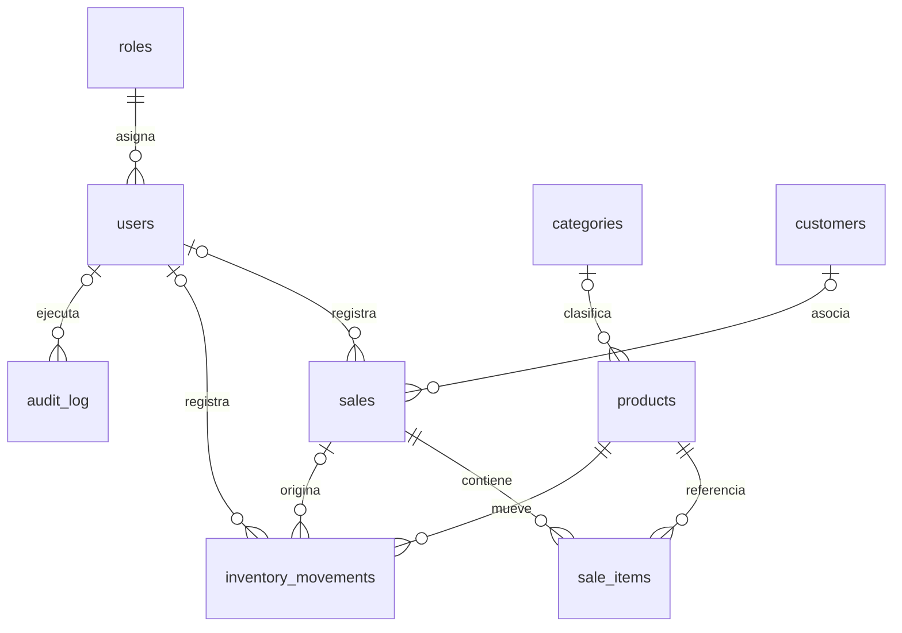

# Datos y arquitectura de Miga

El esquema real está en `schema.sql`; `db.php` aplica esquema, migraciones,
roles, cuatro categorías y ocho productos de demostración al inicializar una BD
vacía. No crea usuarios con contraseñas predeterminadas. No hay seed.sql separado;
la inicialización reproducible se realiza con db.php y debe documentarse como
adaptación del plan, que solicitaba ambos scripts independientes.

| Tabla | Clave y relaciones | Función |
|---|---|---|
| roles | id; name único | Administrador y Cajero |
| users | id; role_id a roles | Cuenta, hash, baja lógica |
| categories | id; name único | Clasificación de pan |
| products | id; category_id a categories; code único | Precio en centavos y existencias |
| customers | id; email único cuando existe | Clientes y puntos |
| sales | id; user_id, cancelled_by a users; customer_id a customers | Cabecera, pago, estado, request_key única |
| sale_items | id; sale_id a sales; product_id a products | Cantidad y precio histórico |
| inventory_movements | id; product_id, user_id, sale_id | Entrada, venta, ajuste, cancelación |
| audit_log | id; user_id a users | Actor, acción, entidad y detalles JSON |
| login_attempts | id | Control de intentos por usuario/IP |
| app_settings | name | Configuración, incluida tasa de impuesto |

Las FK se activan con PRAGMA foreign_keys=ON. CHECK limita existencias,
cantidades, precios, estados y roles. Índices adicionales de db.php cubren
fechas/estado de ventas, movimientos por producto y fecha, y auditoría.
La venta congela nombre/precio en sale_items para conservar el cobro histórico.
products conserva category y category_id por compatibilidad; no afirmar 3FN
estricta hasta revisar esta redundancia. El modelo carece de produccion_diaria
y de un tipo específico de movimiento merma.

Para una BD nueva: definir BAKERY_DB en el entorno del proceso PHP apuntando
a una ruta vacía y cargar la aplicación. No borrar la BD de trabajo para probar.
El archivo .env.example es orientativo: PHP no lo carga automáticamente.
Respaldar la BD con el servidor detenido. No versionar BD ni sesiones.
